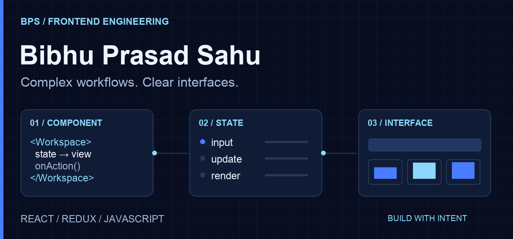
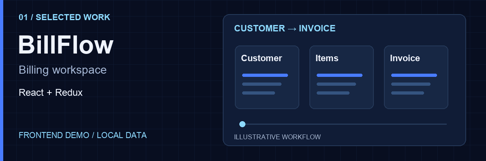
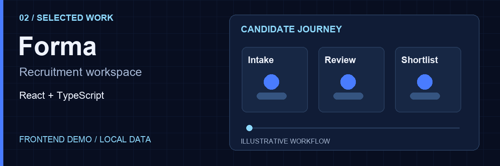

<picture>
  <source media="(prefers-reduced-motion: reduce)" srcset="./assets/profile-cobalt.png" />
  
</picture>

  <a href="#selected-work">Selected work</a> &nbsp; / &nbsp;
  <a href="#engineering-perspective">Engineering perspective</a> &nbsp; / &nbsp;
  <a href="https://www.linkedin.com/in/bibhu-prasad-sahu-8a1908199/">LinkedIn</a> &nbsp; / &nbsp;
  <a href="./assets/Bibhu_Prasad_Sahu_Resume.pdf">Resume</a> &nbsp; / &nbsp;
  <a href="https://x.com/bibhuprasaddd">X</a>

Motion plays once. <a href="./assets/profile-cobalt.png">View the still banner</a>.

### Senior frontend engineer. React and TypeScript.

I’m **Bibhu Prasad Sahu**, a Senior Consultant at **GyanSys Inc.** with nearly five years of experience building **React and TypeScript** interfaces for enterprise semiconductor applications. I work with **Redux Toolkit, D3.js and REST APIs** on analytics dashboards and data-heavy workflows.

I’m interested in the decisions behind a useful interface: how components fit together, where state belongs, and how people move through complex workflows. My aim is to make those decisions clear in both the product and the code.

 

## Selected work

Personal projects exploring practical application workflows. Each repository contains its implementation and setup details.

### 01 / BillFlow

<a href="https://github.com/bibhu-3214/Bill-Management-App">
<picture>
  <source media="(prefers-reduced-motion: reduce)" srcset="./assets/billflow-cobalt.png" />
  
</picture>
</a>

A **React and Redux billing workspace** connecting customers, products, invoice drafts, quotations and collections. I’m exploring form validation, explicit state transitions and connected workflows with encrypted browser-local persistence.

**[Read the code ↗](https://github.com/bibhu-3214/Bill-Management-App)**

Frontend-only personal demo; not a production financial service. The PDF upgrade remains work in progress in a draft PR.

### 02 / Forma

<a href="https://userjobapp.netlify.app/">
<picture>
  <source media="(prefers-reduced-motion: reduce)" srcset="./assets/forma-cobalt.png" />
  
</picture>
</a>

A **React and TypeScript recruitment demo** with candidate intake, search and filtering, and shortlist, reject and reopen workflows. Dark mode and an animated candidate journey bring the workspace together.

**[Explore the live demo ↗](https://userjobapp.netlify.app/)** &nbsp; · &nbsp; **[Read the code ↗](https://github.com/bibhu-3214/Job-App-for-user)**

Synthetic candidates and browser-local persistence. No backend, employer delivery or production recruitment service. The artwork above illustrates the workflow rather than reproducing an app screenshot.

<strong>Also built: Identity & Notes</strong>

Registration, sign-in and account details connected to a personal notes workflow. Explore authenticated navigation, API interactions, validation and note management with React, Redux, React Router and Axios.

[Read the code ↗](https://github.com/bibhu-3214/user-authentication-react-redux)

<a href="https://github.com/bibhu-3214?tab=repositories">Browse all repositories →</a>

## Engineering perspective

**01 — Make complexity understandable.** Give components clear responsibilities and keep data flow explicit.

**02 — Design around the workflow.** Consider navigation, form feedback and the transitions between application states.

**03 — Improve with evidence.** Performance, accessibility and maintainability are areas I care about developing and measuring.

<strong>Open the technical toolkit</strong>

 

| Focus | Technologies |
| :--- | :--- |
| Frontend | JavaScript (ES6+), React, Redux, HTML, CSS |
| State & integration | Redux Thunk, React Router, Axios |
| UI & forms | Material UI, Bootstrap, Formik, Yup |
| Development | Git, GitHub, Postman |
| Exploring | TypeScript, Next.js, Node.js |

 

## Let’s connect

For conversations about **React engineering, frontend architecture, technical writing or collaborative projects**, connect with me on LinkedIn.

**[LinkedIn ↗](https://www.linkedin.com/in/bibhu-prasad-sahu-8a1908199/)** &nbsp; · &nbsp; **[X / Twitter ↗](https://x.com/bibhuprasaddd)**

---

BIBHU PRASAD SAHU &nbsp; / &nbsp; FRONTEND ENGINEERING Clarity in the interface. Intent in the implementation.

