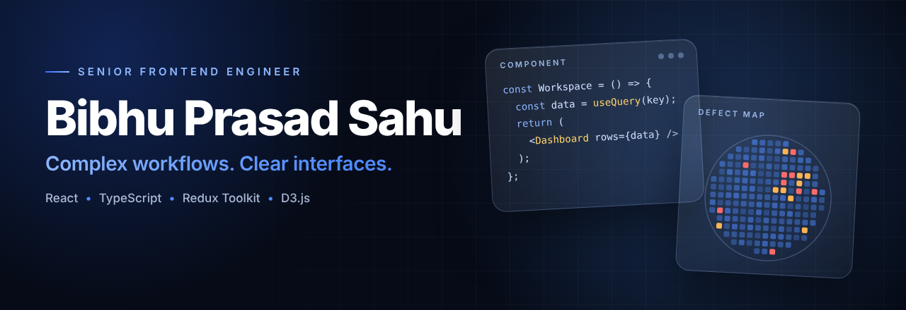
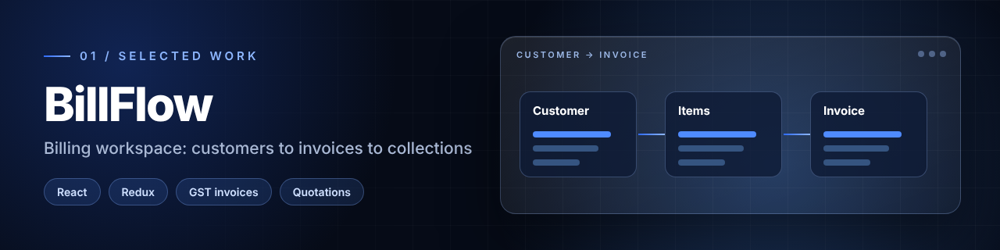
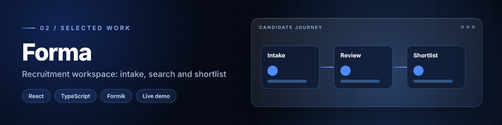

  <a href="#what-i-work-on">What I work on</a> &nbsp;/&nbsp;
  <a href="#selected-work">Selected work</a> &nbsp;/&nbsp;
  <a href="#how-i-build">How I build</a> &nbsp;/&nbsp;
  <a href="https://www.linkedin.com/in/bibhuprasad-sahu/">LinkedIn</a> &nbsp;/&nbsp;
  <a href="./assets/Bibhu_Prasad_Sahu_Resume.pdf">Resume</a> &nbsp;/&nbsp;
  <a href="https://x.com/bibhuprasaddd">X</a>

I'm **Bibhu Prasad Sahu**, a Senior Consultant at **GyanSys Inc.** in Bangalore with nearly five years of experience building **React and TypeScript** interfaces for enterprise semiconductor applications. I care about clear data flow, honest UI states and interfaces that stay readable when the data gets heavy.

## What I work on

- **Analytics dashboards** for wafer inspection, built in a Lerna monorepo.
- **Data visualization** with D3.js and layered canvas rendering for defect data.
- **Entitlement-driven UI** that controls routes, navigation and grid columns.
- **Async data flows** in Redux with centralized token handling and request cancellation.
- **Frontend performance** through caching and state-management optimization.

  
  
  
  
  
  
  

## Selected work

Personal projects built to practise real application workflows. Each repository has its code and setup details.

### BillFlow

A React and Redux billing workspace that connects customers, products, GST invoice workflows, quotations and collections, with encrypted browser-local storage. **[Read the code](https://github.com/bibhu-3214/billflow)**

Frontend-only personal demo; not production accounting software. PDF export is a work in progress.

### Forma

A React and TypeScript recruitment dashboard with candidate intake, search and filters, and shortlist, reject and reopen workflows. **[Live demo](https://userjobapp.netlify.app/)** / **[Read the code](https://github.com/bibhu-3214/forma)**

Fictional candidates and browser-local storage. No backend or real recruitment service.

**Also built:** [user authentication with React and Redux](https://github.com/bibhu-3214/user-authentication-react-redux) / [All repositories](https://github.com/bibhu-3214?tab=repositories)

## How I build

1. **Make complexity understandable.** Give components clear responsibilities and keep data flow explicit.
2. **Design around the workflow.** Think about navigation, form feedback and the transitions between states.
3. **Improve with evidence.** Measure performance, accessibility and maintainability instead of guessing.

## Let's connect

I'm interested in React engineering, frontend architecture and data-heavy interfaces. The best way to reach me is on [LinkedIn](https://www.linkedin.com/in/bibhuprasad-sahu/) or [X](https://x.com/bibhuprasaddd).
